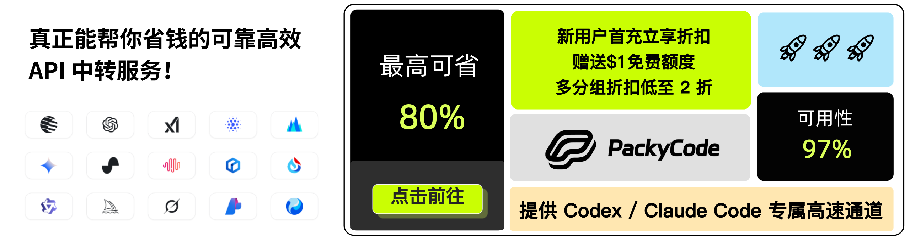
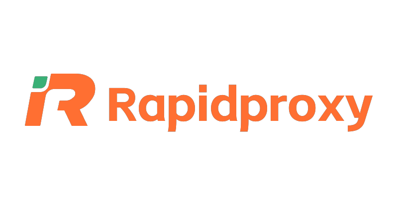
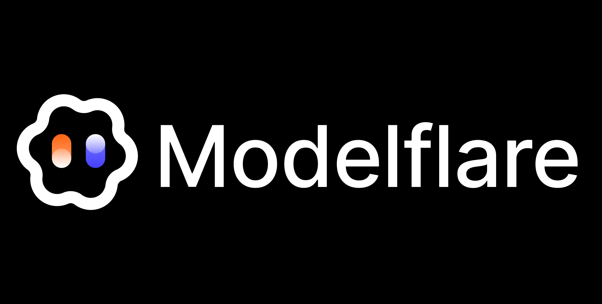

# CLI Proxy API

[English](README.md) | [简体中文](README_CN.md) | 繁體中文 | [日本語](README_JA.md)

如果您想在您的桌面使用 CLIProxyAPI，我們推薦您使用我們的 [EasyCLIProxyAPI](https://github.com/router-for-me/EasyCLIProxyAPI) 桌面客戶端，該客戶端提供了圖形化的配置介面、自動更新、系統托盤整合、一鍵啟動/關閉 CLIProxyAPI 服務等功能。

CLIProxyAPI 是一個為 CLI 提供 OpenAI/Gemini/Claude/Codex/Grok 相容 API 介面的代理伺服器。

您可以通過任何與 OpenAI（包括 Responses）、Gemini（包括 Interactions）或 Claude 相容的客戶端或 SDK，以本地方式或多 CLI 帳戶訪問以下提供商。

<table>
<tbody>
    <tr>
        <th align="center" width="100">提供商</th>
        <th align="center">說明</th>
    </tr>
    <tr>
        <td align="center"></td>
        <td>Kimi 系列模型（Kimi K3、K2.8 Preview 等）。<a href="https://platform.kimi.com/docs/guide/kimi-k3-quickstart">Kimi K3</a> 是 Moonshot AI 迄今能力最強的模型，也是全球首個開源 3T 級模型。K3 擁有 2.8T 引數、原生視覺能力與 100 萬 Token 上下文，面向長週期編碼、知識工作與推理任務。CLIProxyAPI 支援通過 OAuth 或相容 API 接入 Kimi。立即體驗 <strong>Kimi Code 訂閱</strong>（<a href="https://www.kimi.com/code?aff=cliproxyapi">中文站</a>｜<a href="https://www.kimi.ai/code?aff=cliproxyapi">Global</a>），或前往 Kimi 開放平臺（<a href="https://platform.kimi.com?track_id=track-f15622e7182046baa22ca35e006e13a7&aff=cliproxyapi">中文站</a>｜<a href="https://platform.kimi.ai?track_id=track-8a28e4b291d84f62af2fccc3e7a21cb3&aff=cliproxyapi">Global</a>）獲取 <strong>API Key</strong>。感謝 Kimi 對 CLIProxyAPI 及開源社群的支援！</td>
    </tr>
    <tr>
        <td align="center"></td>
        <td>OpenAI GPT-6 系列模型（GPT-6 Astra、GPT-6.1 Sol、GPT-6 Luna），也支援通過 Codex OAuth 接入。Astra 適合複雜推理與程式設計，Sol 兼顧能力與成本，Luna 適合高吞吐量的明確任務。</td>
    </tr>
    <tr>
        <td align="center"></td>
        <td>Anthropic Claude 系列模型（Claude Fable 5.1、Claude Opus 5.5、Claude Sonnet 5.5、Claude Haiku 5.5）。Fable 5.1 適合長週期程式設計與知識工作；Opus 5.5 以更低成本提供強大的智慧體程式設計能力。</td>
    </tr>
    <tr>
        <td align="center"></td>
        <td>Google Gemini 系列模型包括 Gemini 4 Argon 和 Gemini 3.8 Flash。CLIProxyAPI 支援 Gemini API、AI Studio、Vertex AI、Gemini CLI 與 Antigravity 帳戶；可用模型因渠道而異。Gemini 3.8 Flash 是 Google 面向長週期軟體工程與智慧體工作流推出的最新 Flash 模型。Antigravity 的<a href="https://antigravity.google/docs/models/">官方模型可用性文件</a>列明，Claude Sonnet 5.5（thinking）和 Claude Opus 5.5（thinking）向 Google AI Pro（非試用訂閱）、Google AI Ultra 和 Enterprise 開放。</td>
    </tr>
    <tr>
        <td align="center"></td>
        <td>xAI Grok 系列模型（Grok 4.7、Grok 4.7 Build Fast 等）。Grok 4.7 是 SpaceXAI 面向程式設計、智慧體任務與知識工作推出的最新模型。</td>
    </tr>
    <tr>
        <td align="center"></td>
        <td>Meta Muse 系列模型（Muse Wonder Full、Muse Wonder、Muse Spark 1.3 等）。CLIProxyAPI 支援通過 Meta 登入接入 Muse Code 帳戶，也支援 Meta Model API Key；Muse Spark 1.3 面向程式設計與智慧體工作流。Meta 已宣佈 Muse Wonder 可通過 Meta Model API 和 Muse Code 使用，Muse Wonder Full 則面向 Muse Code 訂閱使用者提供。</td>
    </tr>
    <tr>
        <td align="center"><a href="https://devin.ai/cli">Devin</a></td>
        <td>Devin 提供的模型（SWE-2、GPT-6 Astra、Claude Fable 5.1 等）。使用 <code>--devin-login</code> 連線 Devin 帳戶，即可路由該帳戶可用的模型。</td>
    </tr>
</tbody>
</table>

## 贊助商

感謝 PackyCode 對本專案的贊助！

PackyCode 是一家可靠高效的 API 中轉服務商，提供 Claude Code、Codex、Gemini 等多種服務的中轉。

PackyCode 為本軟體使用者提供了特別優惠：使用<a href="https://www.packyapi.com/register?aff=cliproxyapi" target="_blank">此連結</a>註冊，並在充值時輸入 "cliproxyapi" 優惠碼即可享受九折優惠。

---

<table>
<tbody>
<tr>
<td width="180"></td>
<td>感謝 AICodeMirror 贊助了本專案！AICodeMirror 提供 Claude Code / Codex / Gemini 官方高穩定中轉服務，支援企業級高併發、極速開票、7×24 專屬技術支援。 Claude Code / Codex / Gemini 官方渠道低至 3.8 / 0.2 / 0.9 折，充值更有折上折！AICodeMirror 為 CLIProxyAPI 的使用者提供了特別福利，通過<a href="https://www.aicodemirror.ai/register?invitecode=TJNAIF" target="_blank">此連結</a>註冊的使用者，可享受首充8折，企業客戶最高可享 7.5 折！</td>
</tr>
<tr>
<td width="180"></td>
<td>感謝 APIKEY.FUN 贊助本專案！APIKEY.FUN 是一家專業的企業級 AI 中轉站，致力於為企業和個人開發者提供穩定、高效、低成本的 AI 模型 API 接入服務。平臺支援 Claude、OpenAI、Gemini 等主流熱門模型，價格低至官方原價的 7%。通過本專案<a href="https://apikey.fan/register?aff=CLIProxyAPI">專屬連結</a>註冊，還可享受最高 <b>充值永久 95 折</b> 專屬優惠。</td>
</tr>
<tr>
<td width="180"></td>
<td>FennoAI 是一家穩定、高效的API 中轉服務商，目前主要提供 Codex 中轉服務，相容OpenAI 及 Anthropic 協議，可靈活接入 Codex、Claude Code、OpenCode等主流程式設計工具，可穩定支撐千億Token/日的企業級呼叫需求，支援國內及海外主體公對公結算、開票。FennoAI 為 CLIProxyAPI 的使用者提供了專屬福利：通過<a href="https://api.fenno.ai/s/Cvf0">專屬連結</a>購買訂閱，僅需 1.99 美元即可獲得價值 50 美元的 Coding Plan 額度。同時支援邀請獎勵，邀請好友購買最高可獲得 20% 返佣，邀請越多，獎勵越高。</td>
</tr>
<tr>
<td width="180"></td>
<td>感謝 <a href="https://s.qiniu.com/7zUJri">七牛雲AI</a> 贊助本專案！七牛雲AI 是七牛雲(02567.HK)旗下企業級大模型MaaS平臺，一站式呼叫全球 150+ 主流模型，相容全球主流模型廠商協議，覆蓋文字、影像、音訊、影片、檔案處理等全模態處理能力，服務超過 169 萬企業及開發者使用者。專屬福利：企業使用者免費領 <b>1200萬 Token</b>，邀請好友最高得百億 Token。</td>
</tr>
<tr>
<td width="180"></td>
<td>感謝 Cubence 對本專案的贊助！Cubence 是一家可靠高效的 API 中轉服務商，提供 Claude Code、Codex、Gemini 等多種服務的中轉。Cubence 為本軟體使用者提供了特別優惠：使用<a href="https://cubence.com/signup?code=CLIPROXYAPI&source=cpa">此連結</a>註冊，並在充值時輸入 "CLIPROXYAPI" 優惠碼即可享受九折優惠。</td>
</tr>
<tr>
<td width="180"></td>
<td>Swiftproxy 提供 9000萬+ 純淨住宅 IP，覆蓋全球 220+ 個國家和地區，支援 HTTP(S)/SOCKS5、IP 輪換、Sticky Session 及精準地域定位。幫助 AI API 工具和自動化工作流從不同地區穩定訪問線上服務，適用於 API 請求、網頁訪問、資料採集及地域測試等場景。住宅代理低至 &#36;0.7/GB，支援免費測試，使用優惠碼 PROXY90 可享 9 折優惠。<a href="https://www.swiftproxy.net/?code=PR67S9A95">立即體驗 Swiftproxy</a>。</td>
</tr>
<tr>
<td width="180"></td>
<td><a href="https://www.rapidproxy.io/?code=KHM9B6E6M">RapidProxy</a> 是一家專為自動化和多帳戶運營打造的高效能代理服務商，提供純淨住宅代理和原生靜態 ISP IP。RapidProxy 擁有遍佈全球的 9000 萬+住宅 IP，並支援智慧輪換、穩定會話和高併發，是網頁抓取、瀏覽器自動化、社交媒體帳戶管理、電商運營、批次帳戶註冊等場景的理想選擇。住宅代理僅 &#36;0.55/GB 起，流量永不過期。使用優惠碼 RAPID10 可享 9 折優惠，<a href="https://www.rapidproxy.io/?code=KHM9B6E6M">立即開始免費試用</a>。</td>
</tr>
<tr>
<td width="180"></td>
<td>PatewayAI 是一家面向資深 AI 開發者的 API 中繼服務商，完整支援 Claude 與 Codex 系列模型。所有模型均來自官方高品質渠道，絕無稀釋、絕無偽造，計費明細透明可查。經濟模式低至 0.5 折，通過<a href="https://pateway.ai/?ch=jjvdb">此連結</a>註冊即可獲得試用額度，還可參與不定時營銷活動領取免費額度。平臺同時支援企業級併發、專屬管理背景、正式合同與發票，並提供最高 150 美元的雙向推薦獎勵。</td>
</tr>
<tr>
<td width="180"></td>
<td>感謝 OpenLux 對本專案的贊助！Openlux是一個面向企業的一站式 AI 聚合平臺，彙集全球各大廠商主流大模型，平臺提供高效、穩定的服務與及時的技術支援。Claude、OpenAI、Gemini 系列模型基準折扣分別低至官方的 0.882 折、0.4 折和 0.8 折。  CLI Proxy API 使用者還可享受專屬福利：通過專屬連結註冊，充值最高可享 7.5% 優惠！  立即體驗：<a href="https://www.openlux.ai/register?channel=c_6axb1q5n">https://www.openlux.ai/register?channel=c_6axb1q5n</a></td>
</tr>
<tr>
<td width="180"></td>
<td>感謝 Modelflare 贊助本專案！Modelflare：滿血穩定不摻水，低成本享受全球 SOTA 模型。站點由美國 LLC 主體 Havenbyte LLC 運營，支援 GPT、Claude、Gemini、Grok 等主流模型和常用相容協議，還支援 40 多種圖片和影片模型。快取補償是一大亮點：部分 OpenAI 價格優先、穩定和進階分組提供每日 65%、75%、85% 的快取命中率保障，符合條件的請求沒達到目標的，平臺補償差額，結算後可在用量看板檢視。特惠活動：單筆充值 US&#36;20 即可解鎖 0.015 倍價格倍率的 GPT 特惠分組，單筆充值 US&#36;50 即可解鎖 0.03 倍價格倍率的 Claude 特惠分組。通過<a href="https://modelflare.dev/sign-up?utm_source=github&utm_campaign=cliproxyapi">專屬連結</a>註冊即可參與。</td>
</tr>
<tr>
<td width="180"></td>
<td>kedaya.ai 是一家穩定高效的 AI 模型 API 中轉服務商，覆蓋 Claude、GPT、Gemini、Grok、Antigravity、DeepSeek 等主流模型，相容 OpenAI（含 Responses）、Anthropic、Gemini 原生協議，可無縫接入 CLIProxyAPI、Claude Code、Codex、Gemini CLI、Grok CLI 等客戶端。OpenAI及Grok模型價格最低可達官方0.01折！專屬入口：<a href="https://kedaya.ai/register?aff=824X8RAHCYXM">https://kedaya.ai/register?aff=824X8RAHCYXM</a></td>
</tr>
<tr>
<td width="180"></td>
<td>這個 AI 模型中轉服務商可以隨時退款；任意使用者可免費開票；對公對私都能做；主流模型全都有。客服長時間線上等候您的差遣；有事兒您吩咐，主打一個聽勸！  Xcode貴賓入口：<a href="https://xcode.best/register?aff=OuDv">https://xcode.best</a></td>
</tr>
<tr>
<td width="180"></td>
<td>感謝 <a href="https://x.com/chenju_ai">陳局</a> 贊助了本專案！這大概是本欄唯一一個不打站點廣告的。好的開源專案值得被付費，陳局來隨個份子，敬作者一杯。X 上找 <a href="https://x.com/chenju_ai">陳局</a> 吹吹水。</td>
</tr>
</tbody>
</table>

## 功能特性

- 為 CLI 模型提供 OpenAI/Gemini/Claude/Codex/Grok 相容的 API 端點
- 新增 OpenAI Codex（GPT 系列）支援（OAuth 登入）
- 新增 Claude Code 支援（OAuth 登入）
- 新增 Grok Build 支援（OAuth 登入）
- 支援串流、非串流響應，以及受支援場景下的 WebSocket 響應
- 函式呼叫/工具支援
- 多模態輸入（文字、圖片）
- 多帳戶支援與輪詢負載均衡（Gemini、OpenAI、Claude、Grok）
- 簡單的 CLI 身份驗證流程（Gemini、OpenAI、Claude、Grok）
- 支援 Gemini AIStudio API 金鑰
- 支援 AI Studio Build 多帳戶輪詢
- 支援 Claude Code 多帳戶輪詢
- 支援 OpenAI Codex 多帳戶輪詢
- 支援 Grok Build 多帳戶輪詢
- 通過配置接入上游 OpenAI 相容提供商（例如 OpenRouter）
- 可複用的 Go SDK（見 `docs/sdk-usage_CN.md`）

## 新手入門

CLIProxyAPI 使用者手冊： [https://help.router-for.me/](https://help.router-for.me/cn/)

## 管理 API 文件

請參見 [MANAGEMENT_API_CN.md](https://help.router-for.me/cn/management/api)

## 使用量統計

自v6.10.0版本以後，CLIProxyAPI及 [CPAMC](https://github.com/router-for-me/Cli-Proxy-API-Management-Center) 專案不再預置資料統計功能，如果有資料統計需求的請使用以下專案：

### [CPA Usage Keeper](https://github.com/Willxup/cpa-usage-keeper)

獨立的 CLIProxyAPI 使用量持久化與視覺化服務，定期同步 CLIProxyAPI 資料，儲存到 SQLite，提供聚合 API，並內建使用量分析與統計儀表盤。

### [CPA-Manager-Plus](https://github.com/seakee/CPA-Manager-Plus)

面向 CLIProxyAPI 的自託管管理面板與可觀測性平臺，既可作為無需額外服務的輕量管理介面執行，也可通過完整 Manager Server 獲得持久化分析和運維能力。統一管理 OAuth 憑證、AI 提供商、客戶端 API 金鑰、模型別名、外掛和 CPA 配置。基於 SQLite 的請求歷史支援即時監控、失敗診斷，以及按模型、提供商、帳號、金鑰和渠道統計 Token、延遲與預估成本。支援自訂模型價格與一鍵同步，並提供 Codex 與 xAI 配額檢查、重置資訊、帳號健康巡檢及受控恢復操作。支援 Docker 和跨平臺原生部署，資料儲存在本地。

### [Oh-My-CPA](https://github.com/WizisCool/oh-my-cpa)

基於 Ant Design 的現代 CLIProxyAPI v8+ 管理面板，將 CPAMC 核心管理能力與 SQLite 持久化請求記錄、用量分析整合在一起。覆蓋 OAuth 帳號、API 提供商、客戶端金鑰、配額、定價與 CPA 運維；逐請求追蹤延遲、首 Token 延遲（TTFT）、Token 用量和成本，支援多維篩選、即時儀表盤與 Token 熱力圖。支援 OpenRouter 價格同步、自訂定價和逐請求價格快照，保持歷史成本穩定；內建 Agent 與 MCP 工具，輔助用量分析和日常管理。

## SDK 文件

- 使用文件：[docs/sdk-usage_CN.md](docs/sdk-usage_CN.md)
- 進階（執行器與翻譯器）：[docs/sdk-advanced_CN.md](docs/sdk-advanced_CN.md)
- 認證: [docs/sdk-access_CN.md](docs/sdk-access_CN.md)
- 憑據載入/更新: [docs/sdk-watcher_CN.md](docs/sdk-watcher_CN.md)
- 自訂 Provider 示例：`examples/custom-provider`

## 貢獻

歡迎貢獻！請隨時提交 Pull Request。

1. Fork 倉庫
2. 建立您的功能分支（`git checkout -b feature/amazing-feature`）
3. 提交您的更改（`git commit -m 'Add some amazing feature'`）
4. 推播到分支（`git push origin feature/amazing-feature`）
5. 開啟 Pull Request

## 誰與我們在一起？

這些專案基於 CLIProxyAPI:

### [vibeproxy](https://github.com/automazeio/vibeproxy)

一個原生 macOS 選單欄應用，讓您可以使用 Claude Code & ChatGPT 訂閱服務和 AI 程式設計工具，無需 API 金鑰。

### [Subtitle Translator](https://github.com/VjayC/SRT-Subtitle-Translator-Validator)

一款跨平臺的桌面和 Web 應用程式，可通過 CLIProxyAPI 使用您現有的 LLM 訂閱（Gemini、ChatGPT、Claude, etc.）來翻譯和驗證 SRT 字幕 - 無需 API 金鑰。

### [CCS (Claude Code Switch)](https://github.com/kaitranntt/ccs)

CLI 封裝器，用於通過 CLIProxyAPI OAuth 即時切換多個 Claude 帳戶和替代模型（Gemini, Codex, Antigravity），無需 API 金鑰。

### [Quotio](https://github.com/nguyenphutrong/quotio)

原生 macOS 選單欄應用，統一管理 Claude、Gemini、OpenAI 和 Antigravity 訂閱，提供即時配額追蹤和智慧自動故障轉移，支援 Claude Code、OpenCode 和 Droid 等 AI 程式設計工具，無需 API 金鑰。

### [ProxyPilot](https://github.com/Finesssee/ProxyPilot)

原生 Windows CLIProxyAPI 分支，整合 TUI、系統托盤及多服務商 OAuth 認證，專為 AI 程式設計工具打造，無需 API 金鑰。

### [CPA-XXX Panel](https://github.com/ferretgeek/CPA-X)

面向 CLIProxyAPI 的 Web 管理面板，提供健康檢查、資源監控、日誌檢視、自動更新、請求統計與定價展示，支援一鍵安裝與 systemd 服務。

### [CLIProxyAPI Tray](https://github.com/kitephp/CLIProxyAPI_Tray)

Windows 托盤應用，基於 PowerShell 指令碼實現，不依賴任何第三方庫。主要功能包括：自動建立捷徑、靜默執行、密碼管理、通道切換（Main / Plus）以及自動下載與更新。

### [霖君](https://github.com/wangdabaoqq/LinJun)

霖君是一款用於管理AI程式設計助手的跨平臺桌面應用，支援macOS、Windows、Linux系統。統一管理Claude Code、Gemini、OpenAI Codex等AI程式設計工具，本地代理實現多帳戶配額跟蹤和一鍵配置。

### [CLIProxyAPI Dashboard](https://github.com/itsmylife44/cliproxyapi-dashboard)

一個面向 CLIProxyAPI 的現代化 Web 管理儀表盤，基於 Next.js、React 和 PostgreSQL 構建。支援即時日誌流、結構化配置編輯、API Key 管理、Claude/Gemini/Codex 的 OAuth 提供方整合、使用量分析、容器管理，並可通過配套外掛與 OpenCode 同步配置，無需手動編輯 YAML。

### [All API Hub](https://github.com/qixing-jk/all-api-hub)

用於一站式管理 New API 相容中轉站帳號的瀏覽器擴充套件，提供餘額與用量看板、自動簽到、金鑰一鍵匯出到常用應用、網頁內 API 可用性測試，以及渠道與模型同步和重定向。支援通過 CLIProxyAPI Management API 一鍵匯入 Provider 與同步配置。

### [Shadow AI](https://github.com/HEUDavid/shadow-ai)

Shadow AI 是一款專為受限環境設計的 AI 輔助工具。提供無視窗、無痕跡的隱蔽執行方式，並通過區域網實現跨裝置的 AI 問答互動與控制。本質上是一個「螢幕/音訊採集 + AI 推理 + 低摩擦投送」的自動化協作層，幫助使用者在受控裝置/受限環境下沉浸式跨應用地使用 AI 助手。

### [ProxyPal](https://github.com/buddingnewinsights/proxypal)

跨平臺桌面應用（macOS、Windows、Linux），以原生 GUI 封裝 CLIProxyAPI。支援連線 Claude、ChatGPT、Gemini、GitHub Copilot 及自訂 OpenAI 相容端點，具備使用分析、請求監控和熱門程式設計工具自動配置功能，無需 API 金鑰。

### [CLIProxyAPI Quota Inspector](https://github.com/AllenReder/CLIProxyAPI-Quota-Inspector)

上手即用的面向 CLIProxyAPI 跨平臺配額查詢工具，支援按帳號展示 codex 5h/7d 配額視窗、按計劃排序、狀態著色及多帳號彙總分析。

### [CLIProxy Pool Watch](https://github.com/murasame612/CLIProxyPoolWidget)

原生 macOS SwiftUI 應用，用於監控 CLIProxyAPI 池中的 ChatGPT/Codex 帳號額度。通過 Management API 展示帳號可用狀態、Plus 基準容量、5 小時與周額度進度條、套餐權重和恢復預測。

### [Panopticon](https://github.com/eltmon/panopticon-cli)

面向 AI 程式設計助手的多智慧體編排工具。它將 CLIProxyAPI 作為本地 sidecar 執行，使其智慧體可以通過 ChatGPT 訂閱驅動 GPT 模型，並將 Claude Code 指向 Anthropic 相容端點，無需 OpenAI API 金鑰。

### [Tunnel Agent](https://github.com/Villoh/tunnel-agent)

Windows 桌面 UI，通過單一介面管理 CLIProxyAPI 和 Perplexity WebUI Scraper，靈感來自 Quotio 和 VibeProxy。連線 OAuth 提供商（Claude、Gemini、Codex、Kimi、Antigravity）、自訂 API 金鑰和 Perplexity 會話帳號，然後將任意程式設計智慧體指向本地端點。

### [Quotio Desktop](https://github.com/xiaocoss/quotio-desktop)

Quotio 的跨平臺（Tauri）移植版，支援 Windows / macOS / Linux。通過 CLIProxyAPI 管理多帳號代理池（Codex、Claude Code、GitHub Copilot、Gemini、Antigravity、Kiro、Cursor、Trae、GLM），提供每帳號 5 小時 / 每週額度進度條、Codex 主動重置次數與一鍵重置、智慧排程、用量統計及 Codex 多開例項，無需 API 金鑰。

### [Universal Chat Provider](https://github.com/maxdewald/vscode-universal-chat-provider)

VS Code 擴充套件，可將你的 Claude、ChatGPT/Codex、Antigravity、Grok 和 Kimi 訂閱作為原生語言模型接入 GitHub Copilot Chat，並且也可用於生成 Git 提交資訊、聊天標題和摘要。它以完全託管的背景生命週期執行 CLIProxyAPI（下載、驗證、監督），並在所有視窗間共享，因此無需配置。無需 API 金鑰，只需 OAuth。

### [CPA-Tray-Powershell](https://github.com/ztzpro/CPA-Tray-Powershell.git)

基於 PowerShell 的 Windows CLIProxyAPI 托盤啟動工具。支援無終端視窗背景執行、開啟管理頁面、關閉管理視窗後保持後端執行，並可通過托盤重新開啟頁面；同時支援啟動時自動檢查 CLIProxyAPI 更新、SHA-256 校驗與失敗回滾、一鍵重啟並更新 CLIProxyAPI、基於 PID 校驗的程序管理以及安全停止服務。

### [Grok Search MCP](https://github.com/MapleMapleCat/Grok_Search_Mcp)

一個僅支援 HTTP 傳輸的模型上下文協議（MCP）伺服器，使用 CLIProxyAPI 部署為 MCP 客戶端提供由 Grok 驅動的即時網頁搜尋、X/Twitter 搜尋和模型發現功能。它還提供 MCP 傳輸、客戶端 API 金鑰管理、配額、用量跟蹤和 Web 管理面板。

### [AIUsage](https://github.com/sylearn/AIUsage)

原生 macOS SwiftUI AI 訂閱看板與程式設計代理管理器。可在應用內完整管理官方 CLIProxyAPI 釋出版（下載、校驗、守護執行、更新與回滾），匯聚 OAuth 帳號與即時模型，並將同一閘道器接入 Codex、Claude Code/Science、OpenCode 或 OpenAI/Anthropic/Gemini 客戶端；支援可選區域網訪問。

### [Claude Dialects](https://github.com/stefandevo/claude-dialects)

執行多個具有原生體驗的 Claude Code 命令，每個命令由不同的模型（Codex、GLM、Kimi、Gemini、Grok、MiniMax、DeepSeek、Cursor、Copilot、Claude）驅動。每個命令都會啟動真正的 Claude Code 介面，並擁有獨立的配置、歷史記錄、埠，以及通過 Go SDK 連線的嵌入式 CLIProxyAPI 例項，無需單獨安裝代理。僅支援 macOS。詳情請訪問 [claude-dialects.cc](https://claude-dialects.cc/)。

### [WebBrain](https://github.com/webbrain-one/webbrain)

可將 CLIProxyAPI 的本地 OpenAI 相容端點用作模型提供商的瀏覽器智慧體。通過 EasyCLIProxyAPI 使用 CLIProxyAPI 時，請參閱 WebBrain 提供的獨立[設定、安全與帳號風險指南](https://webbrain.one/docs/zh/easy-cli-proxy/)。

### [Infinitus](https://github.com/deathemperor/infinitus)

原生 macOS 選單欄應用，通過 CLIProxyAPI 的管理 API 管理多個 Claude 帳號（也支援 claude-swap 與 9Router）：5 小時 / 7 天 / 按模型的配額儀表，彈出視窗內切換 / 暫停 / 星標帳號，按當前消耗速度預測各視窗何時耗盡，並可在 iPhone 上同步檢視。

### [PiCloud](https://github.com/cookerpapa/pi-cloud)

基於 Pi SDK 的自託管程式設計 Agent 平臺，提供 Web 介面、併發子 Agent 和 CubeSandbox KVM 工作空間。使用 CLIProxyAPI 作為模型供應商閘道器，將供應商憑據保留在客戶機工作空間之外。

### [cc-status-line](https://github.com/kinka/cc-status-line)

Claude Code 狀態列，按當前 CPA 例項展示 Codex / Grok / Antigravity / Claude 的逐帳戶額度（5h / 7d / 周）與重置倒計時。根據 `ANTHROPIC_BASE_URL` 選擇例項，通過 Management API 採集額度。

### [CLIProxy Quota Tray](https://github.com/ZYHUO/CLIProxy-Quota-Tray)

適用於 CLIProxyAPI 的跨平臺 Electron 托盤儀表盤。展示 ChatGPT/Codex、Claude、Gemini/Antigravity、Grok、Kimi 和 Cursor 各帳戶的真實 OAuth 配額視窗，預估用量佇列成本，並跟蹤 OpenAI/Claude 服務狀態。深色終端風格 UI；支援在 Windows 和 Linux 上執行。

### [panel4cliproxyapi](https://github.com/yaanlaan/panel4cliproxyapi)

面向 CLIProxyAPI 的現代化 Web 控制台與管理大盤，基於 React 19 與 Tailwind CSS 構建。支援多平臺一鍵 OAuth 網頁授權與特色區域網/跨裝置換碼輔助、圖形化免手寫 YAML 系統配置、帳號池呼叫量與成功率走勢圖表、客戶端 API Key 統一管理、核心版本檢測與熱過載，以及原生打字機串流 API 測試臺。

### [sub2api](https://github.com/PlaygrndLabs/sub2api)

基於 Cloudflare 的 LLM 閘道器與代理伺服器：一鍵將 CLIProxyAPI 部署到 Cloudflare Workers + Containers。登入與配置持久化儲存在 R2，控制台受密碼保護，在建立客戶端 API Key 之前拒絕所有 API 請求。

### [Hermes CLIProxyAPI Provider](https://github.com/duu261/hermes-cliproxyapi-provider)

[Hermes Agent](https://github.com/NousResearch/hermes-agent) 的模型提供方外掛：為每個 CLIProxyAPI 提供方註冊一個 Hermes 提供方，各自使用其執行器接受的協議（Anthropic Messages、Responses 或 Chat Completions），上下文視窗與推理等級讀取自 CLIProxyAPI。可選只讀 Management API 查詢，用於精確的提供方分組。已收錄於 [Hermes 外掛目錄](https://hermes-agent.nousresearch.com/docs/plugins/cliproxyapi-provider)：`hermes plugins install cliproxyapi-provider`。

> [!NOTE]  
> 如果你開發了基於 CLIProxyAPI 的專案，請提交一個 PR（拉取請求）將其新增到此列表中。

## 更多選擇

以下專案是 CLIProxyAPI 的移植版或受其啟發：

### [9Router](https://github.com/decolua/9router)

基於 Next.js 的實現，靈感來自 CLIProxyAPI，易於安裝使用；自研格式轉換（OpenAI/Claude/Gemini/Ollama）、組合系統與自動回退、多帳戶管理（指數退避）、Next.js Web 控制台，並支援 Cursor、Claude Code、Cline、RooCode 等 CLI 工具，無需 API 金鑰。

### [OmniRoute](https://github.com/diegosouzapw/OmniRoute)

程式碼不止，創新不停。智慧路由至免費及低成本 AI 模型，並支援自動故障轉移。

OmniRoute 是一個面向多供應商大語言模型的 AI 閘道器：它提供相容 OpenAI 的端點，具備智慧路由、負載均衡、重試及回退機制。通過新增策略、速率限制、快取和可觀測性，確保推理過程既可靠又具備成本意識。

### [Codex Switch](https://github.com/9ycrooked/CodexSwitch)

這是一個使用 Tauri 2 + Vue 3 構建的工具，用於管理多個 OpenAI Codex 桌面帳戶。它可以在已儲存的 ChatGPT/Codex 認證配置之間切換，即時檢視 5 小時和每週配額使用情況，驗證 token 健康狀態，檢視當前帳戶詳情，並在無需手動複製的情況下匯入或儲存 auth.json 檔案。

### [cliproxy-rs](https://github.com/vayungodara/cliproxy-rs)

CLIProxyAPI 的 Rust 移植版，讀取相同的 `config.yaml` 和認證檔案，提供相同的路由和 v8 管理 API，可以在兩者之間雙向切換。單個二進位制檔案內建管理面板（按帳戶顯示 5 小時和每週配額、帳戶登入、客戶端配置指南），並新增可選的 `soonest-reset` 路由策略，優先使用每週額度最先重置的帳戶。

> [!NOTE]  
> 如果你開發了 CLIProxyAPI 的移植或衍生專案，請提交 PR 將其新增到此列表中。

## 許可證

此專案根據 MIT 許可證授權 - 有關詳細資訊，請參閱 [LICENSE](LICENSE) 檔案。

## 寫給所有中國網友的

QQ 群：1081218164

或

Telegram 群：https://t.me/CLIProxyAPI
